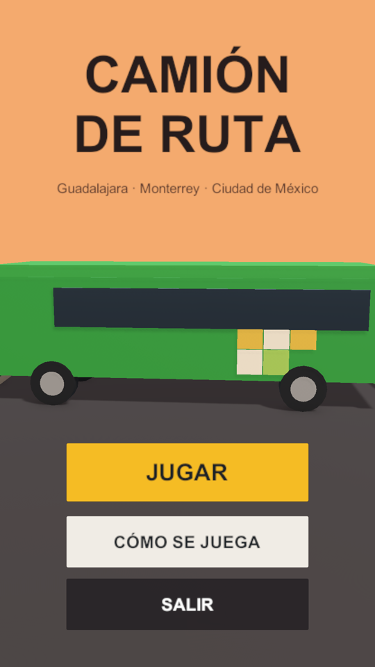
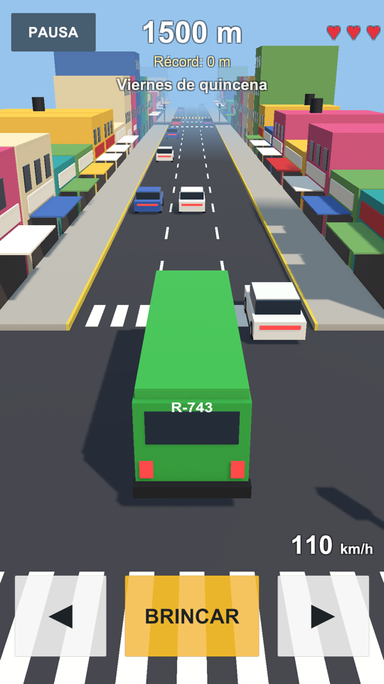
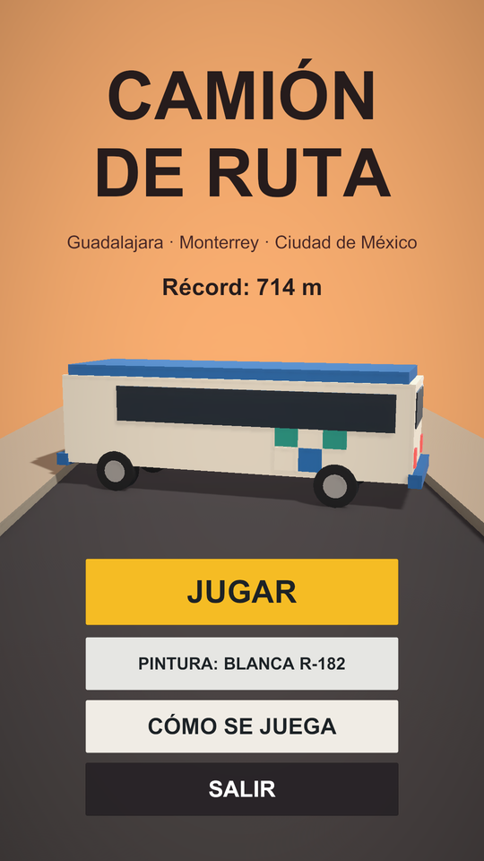
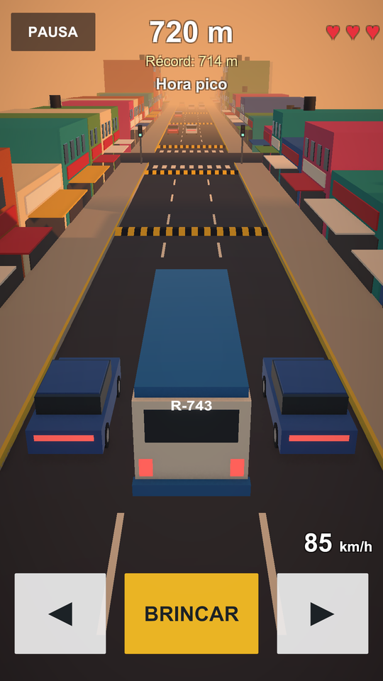
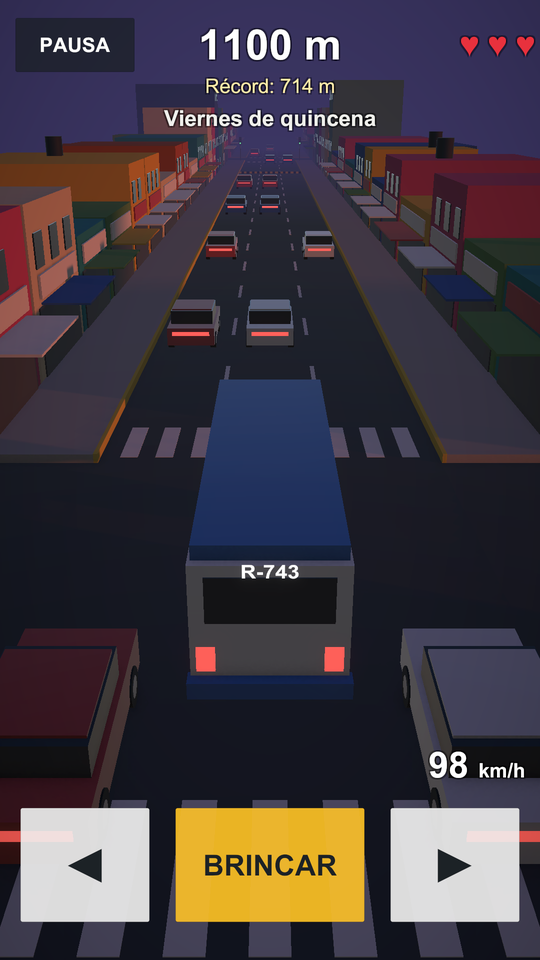

# Camión de ruta

Videojuego 3D para teléfono de IH743 · Optativa Abierta III, unidad 4 (Universidad de Guadalajara, Licenciatura en
Desarrollo de Sistemas Web). Hiram Agustín Acevedo López.

Un camión de ruta avanza solo por una avenida mexicana: hay que cambiar de carril, brincar los topes y no chocar con los
autos parados ni con los que lo rebasan. Guadalajara, Monterrey y Ciudad de México serán los niveles.

## Lo que hay en la entrega 4.1

  
  

- **Interfaz para teléfono vertical:** menú (Jugar, Cómo se juega, Salir) y escena de la avenida, con el lienzo escalado
  a 1080 × 1920, área segura para la muesca, botones táctiles (◄, BRINCAR, ►) y pausa.
- **Movimiento en los tres ejes con un Rigidbody:** el camión avanza en Z, cambia de carril en X y brinca en Y; los topes
  lo levantan y lo bajan.
- **Colisiones:** BoxCollider en el camión y en los autos, MeshCollider convexo en los topes. Al chocar con un auto, el
  camión se detiene y aparece el aviso; al llegar a la base termina el tramo de prueba.
- **Cámara:** sigue al camión sólo en X y Z; su altura no cambia y su distancia en Z es fija (−15 m).

## Lo que hay en la entrega 4.2

  
  

- **Contador en pantalla:** arriba, al centro, un texto de UI con los metros que lleva el camión; sube parejo con su avance
  en Z.
- **Curva de dificultad:** el camión sale a 36 km/h y acelera con los metros recorridos hasta 72 km/h a los 380 m. Las tres
  cifras y la forma de la curva (`AnimationCurve`) se ajustan en el Inspector, en el componente `CamionRuta`.
- **Récord guardado:** la mejor distancia se guarda con `PlayerPrefs` al chocar, al llegar a la base o al volver al menú
  desde la pausa, y aparece en el menú y debajo del contador.
- **Menú en vertical:** la cámara se aleja según la proporción de la pantalla para que el camión de exhibición quepa
  completo mientras gira, en 9:16 y en 20:9; en horizontal se queda donde estaba.

## Lo que hay en la entrega 4.3

  
  
  

- **Avenida sin fin por tramos:** `GeneradorAvenida` crea tramos de 40 m delante del camión mientras se juega y destruye los
  que quedan atrás de la cámara; siempre hay siete u ocho armados. Cada tramo es una porción (un prefab): cuadra de casas,
  cuadra de comercios o cruce con paso peatonal y semáforo, con sus autos parados y topes repartidos por código. Ya no hay
  base: la avenida no se acaba.
- **Velocidad y velocímetro:** el camión sale a 36 km/h, llega a 72 km/h a los 380 m, a 95 km/h a los 1,000 m y a 110 km/h
  a los 1,500 m; de ahí sigue subiendo parejo, unos 2.5 km/h cada 100 m, hasta su tope de 200 km/h a los 5,000 m. El
  velocímetro, en la esquina inferior derecha, dice a cuántos km/h va.
- **Tres vidas en los topes:** desde 120 km/h los topes se brincan. Pasar uno sin brincar quita una de las tres vidas (los
  corazones de arriba a la derecha) y frena el camión a 32 km/h, que luego vuelve a acelerar; sin vidas, se acaba la partida.
- **Cuatro etapas de tráfico:** tráfico ligero desde 0 m, tráfico medio desde 250 m, hora pico desde 600 m y viernes de
  quincena desde 1,000 m. Las filas de obstáculos se juntan (de 30 a 40 m entre una y otra hasta 18 a 26 m) y salen más
  seguido dos autos juntos, siempre con un carril libre; cuando entre dos filas no da tiempo de cruzar dos carriles, ese
  carril queda junto a uno de los libres de la fila anterior, y a más velocidad las filas se separan lo justo para que siempre
  dé tiempo de pasarse al carril de junto. El nombre de la etapa aparece debajo del récord.
- **Autos que rebasan:** desde el tráfico medio vienen autos por detrás, más rápido que el camión, por el carril de al lado.
  El tranquilo lo rebasa, busca su lugar y ahí se queda: si encuentra un auto parado, se pasa a un carril libre que no sea el
  del camión o se forma detrás. Desde los 2,500 m salen también autos locos, que pasan mucho más rápido y se pierden de
  vista. Ninguno se cambia al carril del camión cerca de él, y si el camión se le mete enfrente, frena detrás. Cada etapa
  trae más: 3 por kilómetro en el tráfico medio, 6 en la hora pico y 10 en el viernes de quincena.
- **Etapas en el Inspector:** cada etapa es un `ScriptableObject` (`EtapaAvenida`, en `Assets/Etapas/`) que se crea con
  clic derecho > Create > Camión de ruta > Etapa de la avenida. Ahí se ajusta desde qué metro rige, qué porciones la
  componen y con qué peso, la separación entre filas, la probabilidad de dos autos y de tope, y cuántos autos por
  kilómetro vienen a rebasar. En el componente `GeneradorAvenida` van el largo del tramo, los tramos por delante, los
  autos, el tope, los autos que rebasan, la salida libre, la semilla y la lista de etapas.
- **Bucle de juego:** al chocar se guarda el récord y el aviso dice a cuántos metros llegaste y qué pasó: un auto parado,
  uno que te rebasaba (y quién se cambió de carril) o que te quedaste sin vidas en los topes. JUGAR DE NUEVO (`ControlPartida.ReiniciarNivel`) vuelve a empezar en la misma
  escena: el contador regresa a 0 m, el camión a la salida y a 36 km/h, y el generador arma una avenida nueva.

## Lo que hay en la entrega 4.4

  
  
  

- **La hora del día por etapa:** cada etapa trae su ambiente en el Inspector: el color del cielo (el fondo de la cámara y
  la niebla), el color, la fuerza, la altura y el giro del sol, y el color de la luz ambiental. `LuzDelDia` lee la etapa del
  metro donde va el camión y pasa de un ambiente al otro en 3 segundos: mañana en el tráfico ligero, mediodía en el tráfico
  medio (cielo más azul y sol alto), atardecer en la hora pico (cielo naranja, sol bajo y sombras largas) y anochecer en el
  viernes de quincena (cielo morado y sol casi en el horizonte). JUGAR DE NUEVO regresa a la mañana de golpe.
- **Pintura del camión:** el botón PINTURA del menú cambia la del camión que gira entre la verde de Mi Transporte, la roja
  de las R-400 y la blanca con techo y defensas azules del trompudo R-182, y la guarda con `PlayerPrefs`: en la avenida el
  camión sale con esa pintura, también la próxima vez que se abre el juego. Cada pintura es un `ScriptableObject`
  (`PinturaCamion`, en `Assets/Pinturas/`) que se crea con clic derecho > Create > Camión de ruta > Pintura del camión: el
  color de la carrocería, del techo, de los cuadros y de las defensas, su suavidad y qué tan metálica es. `PintarCamion` la
  aplica con materiales propios del camión, así no tiñe a los autos que comparten material con él.
- **Posprocesado:** un volumen global en cada escena (`Assets/Posproceso/Brillo suave`) con un bloom suave, que sólo hace
  brillar lo que brilla más que el blanco (faros, calaveras, letrero de ruta, semáforos y direccionales), y un viñeteado
  ligero.

## Controles

- Teléfono: ◄ y ► cambian de carril, BRINCAR salta y PAUSA está arriba a la izquierda.
- Computadora: flechas o A y D para el carril; barra, W o flecha arriba para brincar.
- En el menú, PINTURA cambia la pintura del camión.

## Abrir el proyecto

Unity 6000.5.9f1 con la plantilla Universal 3D. Se abre la carpeta desde Unity Hub, después `Assets/Scenes/Menu.unity`,
y Play.

## Estructura

- `Assets/Scripts/`: `CamionRuta` (movimiento, curva de velocidad y colisiones), `GeneradorAvenida` (los tramos sin fin,
  sus obstáculos y los autos que rebasan), `EtapaAvenida` (las etapas de la curva de dificultad), `AutoQueRebasa` (el auto
  que viene por detrás y rebasa, tranquilo o loco), `ControlPartida` (el bucle de juego: choque, vidas y jugar de nuevo), `Marcador`
  (contador de metros, velocímetro, récord con `PlayerPrefs` y etapa en pantalla), `CamaraSeguimiento`,
  `EncuadreExhibicion` (en vertical, la cámara del menú se aleja hasta que el camión quepa completo), `Navegacion`
  (escenas y paneles), `AreaSegura`, `ContenidoVertical` (los paneles caben sin encimarse en cualquier proporción de
  pantalla), `Girar`, `TextoConProfundidad`, `LuzDelDia` (la hora del día de cada etapa), `PinturaCamion` (una pintura del
  camión), `PintarCamion` (aplica la pintura elegida) y `BotonPintura` (el botón PINTURA del menú).
- `Assets/Scenes/`: `Menu` y `Ruta`.
- `Assets/Etapas/`: Tráfico ligero, Tráfico medio, Hora pico y Viernes de quincena.
- `Assets/Pinturas/`: Verde Mi Transporte, Roja R-400 y Blanca R-182.
- `Assets/Posproceso/`: el perfil del volumen, con el bloom y el viñeteado.
- `Assets/Prefabs/`: el camión, tres autos, sus tres variantes que rebasan (con direccionales) y el tope, armados con
  figuras básicas de Unity. El camión lleva el número R-743 y la pintura elegida en el menú; el modelo definitivo llega en
  las siguientes entregas. En `Tramos/`, las cinco porciones de la avenida: dos cuadras de casas, dos de comercios y el
  cruce.
- `Assets/Shaders/`: el texto 3D del número de ruta, que respeta la profundidad.

Cada entrega lleva su etiqueta: `act-4.1`, `act-4.2`, etcétera.
