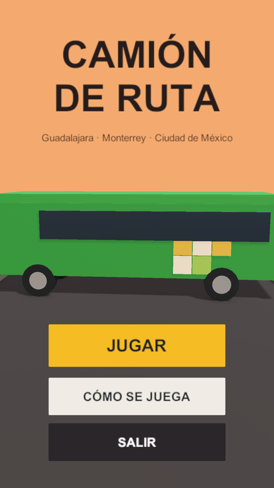
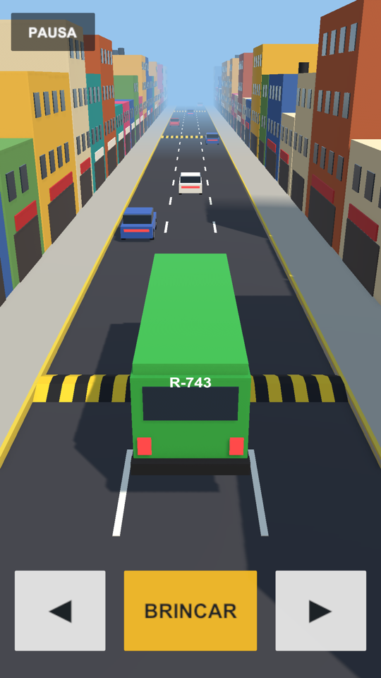

# Camión de ruta

Videojuego 3D para teléfono de IH743 · Optativa Abierta III, unidad 4 (Universidad de Guadalajara, Licenciatura en
Desarrollo de Sistemas Web). Hiram Agustín Acevedo López.

Un camión de ruta avanza solo por una avenida mexicana: hay que cambiar de carril, brincar los topes y no chocar con los
autos parados. Guadalajara, Monterrey y Ciudad de México serán los niveles.

## Lo que hay en la entrega 4.1

  
  

- **Interfaz para teléfono vertical:** menú (Jugar, Cómo se juega, Salir) y escena de la avenida, con el lienzo escalado
  a 1080 × 1920, área segura para la muesca, botones táctiles (◄, BRINCAR, ►) y pausa.
- **Movimiento en los tres ejes con un Rigidbody:** el camión avanza en Z, cambia de carril en X y brinca en Y; los topes
  lo levantan y lo bajan.
- **Colisiones:** BoxCollider en el camión y en los autos, MeshCollider convexo en los topes. Al chocar con un auto, el
  camión se detiene y aparece el aviso; al llegar a la base termina el tramo de prueba.
- **Cámara:** sigue al camión sólo en X y Z; su altura no cambia y su distancia en Z es fija (−15 m).

## Lo que hay en la entrega 4.2

- **Contador en pantalla:** arriba, al centro, un texto de UI con los metros que lleva el camión; sube parejo con su avance
  en Z.
- **Curva de dificultad:** el camión sale a 10 m/s y acelera con los metros recorridos hasta 20 m/s a los 380 m. Las tres
  cifras y la forma de la curva (`AnimationCurve`) se ajustan en el Inspector, en el componente `CamionRuta`.
- **Récord guardado:** la mejor distancia se guarda con `PlayerPrefs` al chocar, al llegar a la base o al volver al menú
  desde la pausa, y aparece en el menú y debajo del contador.
- **Menú en vertical:** la cámara se aleja según la proporción de la pantalla para que el camión de exhibición quepa
  completo mientras gira, en 9:16 y en 20:9; en horizontal se queda donde estaba.

## Controles

- Teléfono: ◄ y ► cambian de carril, BRINCAR salta y PAUSA está arriba a la izquierda.
- Computadora: flechas o A y D para el carril; barra, W o flecha arriba para brincar.

## Abrir el proyecto

Unity 6000.5.9f1 con la plantilla Universal 3D. Se abre la carpeta desde Unity Hub, después `Assets/Scenes/Menu.unity`,
y Play.

## Estructura

- `Assets/Scripts/`: `CamionRuta` (movimiento, curva de dificultad y colisiones), `Marcador` (contador de metros y récord
  con `PlayerPrefs`), `CamaraSeguimiento`, `EncuadreExhibicion` (en vertical, la
  cámara del menú se aleja hasta que el camión quepa completo), `Navegacion` (escenas y paneles),
  `AreaSegura`, `ContenidoVertical` (los paneles caben sin encimarse en cualquier
  proporción de pantalla), `Girar` y `TextoConProfundidad`.
- `Assets/Scenes/`: `Menu` y `Ruta`.
- `Assets/Prefabs/`: el camión, tres autos y el tope, armados con figuras básicas de Unity. El camión lleva el verde de
  las unidades actuales de Guadalajara y el número R-743; el modelo definitivo y las otras pinturas llegan en las
  siguientes entregas.
- `Assets/Shaders/`: el texto 3D del número de ruta, que respeta la profundidad.

Cada entrega lleva su etiqueta: `act-4.1`, `act-4.2`, etcétera.
